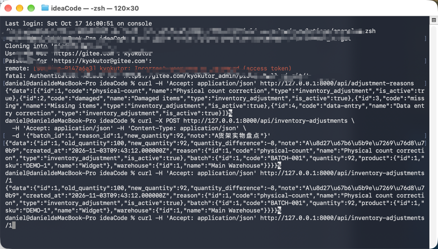

# Batch quantity adjustment API

This is a demo presentation by Ren Xudong.


English | [中文说明](README.zh-CN.md)

Standalone Laravel 12 demo with predefined reasons, stock adjustment history, and transactional quantity updates. PHP 8.2+ and Composer 2 are required, with Laravel's standard PHP extensions and PDO SQLite (or PDO MySQL/PostgreSQL). Node is not required.

## Setup

```sh
composer run setup
php artisan serve
```

Setup installs dependencies, creates `.env`, generates the application key, creates the SQLite file, and migrates/seeds the database. For manual setup:

```sh
composer install
cp .env.example .env
php artisan key:generate
touch database/database.sqlite
php artisan migrate --seed
php artisan serve
```

To use MySQL or PostgreSQL, configure `DB_CONNECTION` and the connection credentials in `.env` before migrating. Use MySQL/InnoDB or PostgreSQL for concurrent writers: those engines provide the row locks used here. SQLite is convenient for the local demo but does not implement `SELECT FOR UPDATE`; concurrent writes can fail with a busy/locked error rather than serialize as row locks do.

## Demo data

On a fresh database, batch 1 (`BATCH-001`) contains 100 Widgets in Main Warehouse; batch 2 contains 50 Gadgets in Overflow Warehouse. Reasons 1–4 are physical count correction, damaged items, missing items, and data entry correction. An inactive inventory reason and an active customer-return reason demonstrate filtering and rejection. IDs below assume a fresh database. Rerunning `php artisan db:seed` preserves existing stock and records.

## API

All responses use a `data` envelope. Send JSON and `Accept: application/json`.

| Method | URL | Result |
| --- | --- | --- |
| GET | `/api/adjustment-reasons` | 200; active inventory reasons |
| POST | `/api/inventory-adjustments` | 201; created adjustment and relations |
| GET | `/api/inventory-adjustments/{id}` | 200; adjustment and relations, or 404 |

```sh
curl -H 'Accept: application/json' http://localhost:8000/api/adjustment-reasons

curl -X POST http://localhost:8000/api/inventory-adjustments \
  -H 'Accept: application/json' -H 'Content-Type: application/json' \
  -d '{"batch_id":1,"reason_id":1,"new_quantity":92,"note":"Physical count on shelf A"}'

curl -H 'Accept: application/json' http://localhost:8000/api/inventory-adjustments/1
```

The example records `old_quantity: 100`, `new_quantity: 92`, and `quantity_difference: -8`, and sets batch quantity to 92. The response includes the reason and a batch object containing its product and warehouse. `batch.quantity` on subsequent reads is the current stock; the adjustment's old/new quantities remain historical values.

Required inputs: existing `batch_id`, active inventory `reason_id`, and integer `new_quantity` from 0 to 2,147,483,647. Optional `note` is nullable and limited to 2,000 characters. Invalid input returns HTTP 422 with Laravel's `message` and field-keyed `errors`. Reason eligibility errors say “Choose an active inventory adjustment reason.” Negative and fractional stock are rejected. Unchanged counts are allowed and recorded with difference zero.

## Design decisions

- Warehouses and products each have many batches; batches have many adjustments; each adjustment belongs to a predefined reason. Foreign keys restrict deletion of referenced records.
- A Form Request handles validation, controllers coordinate the operation, and API Resources define explicit output fields. No service/repository abstraction is needed for this small workflow.
- A transaction locks the batch before reading its old quantity, rechecks and locks the reason, inserts the audit record, and updates stock. Any failure rolls both writes back. Deadlocks are retried up to three times. See [Laravel's transaction documentation](https://laravel.com/docs/12.x/database#database-transactions).
- Clients submit an absolute counted quantity, not a delta. Sequential submissions use the latest stored quantity for history. There is no stale-count conflict detection or idempotency key; repeated submissions create separate records.
- Reason IDs retain the predefined classification; names are read from the related reason, not copied as historical snapshots. No reason editing or adjustment editing/deletion API is exposed.
- Authentication is intentionally outside this standalone local demo. Add authorization and user attribution before using it for a real warehouse.

## Tests

```sh
composer test
vendor/bin/pint --test
```

Feature tests use an isolated in-memory SQLite database and cover filtering, audit values, stock updates, related data, invalid reasons/input, zero/increased/unchanged quantities, missing records, reseeding, and transaction rollback. SQLite tests do not prove concurrent row locking; verify concurrency against the intended MySQL/PostgreSQL deployment.

PHP and Composer were unavailable in the authoring environment, so the test suite and formatter have not been executed there. No dependency lockfile was generated; run Composer and commit the resulting `composer.lock` when preparing the shared repository.

## Publishing

The source is ready for a shared repository. To publish to a repository you control:

```sh
git init
git add .
git commit -m "Add batch quantity adjustment API demo"
git branch -M main
git remote add origin <your-repository-url>
git push -u origin main
```

Do not commit `.env`, `vendor`, or the SQLite database; the supplied `.gitignore` excludes them.
